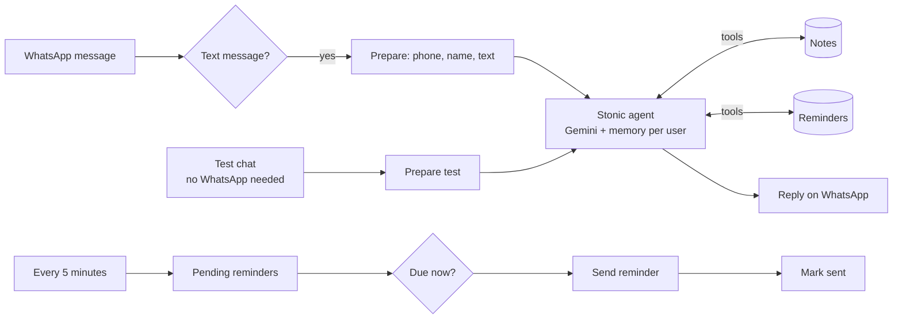

# Stonic · WhatsApp AI Assistant (Roman Urdu)

Stonic is my own AI assistant that runs on WhatsApp. It talks in **Roman Urdu, Urdu or English**, saves notes, sets reminders and helps with everyday questions, built entirely in n8n.

> **Status: v1, early build.** Built and structured, not yet production-tested. Feedback and issues are welcome.

## What it can do
- **Chat** in the user's language: short, friendly, WhatsApp-style replies.
- **Notes:** "Yaad rakhna: Ali ko 2000 udhaar diye" is saved, and "mere notes dikhao" shows them.
- **Reminders:** "kal shaam 5 baje physics yaad dilana" is converted to an exact Pakistan time and sent on WhatsApp when it is due.
- **Memory per user:** every phone number has its own conversation memory.

## Safety rules (in the system prompt)
- Never gives medicine doses, diagnoses or treatment. It suggests seeing a doctor, or calling 1122 in an emergency. It can set appointment reminders.
- Never asks for or stores passwords, OTPs, CNIC or bank details.
- Says "I'm not sure" instead of inventing answers.

## Files
| File | What it is |
|---|---|
| `workflows/1-whatsapp-assistant.json` | Main assistant: WhatsApp trigger, test chat, agent, notes and reminder tools, WhatsApp reply |
| `workflows/2-reminder-sender.json` | Every 5 minutes, sends due reminders and marks them sent |
| `docs/setup-guide-roman-urdu.txt` | Step-by-step setup guide in Roman Urdu |

## Setup (short)
1. Import both JSON files in n8n (**Import from File**).
2. Create two data tables: `stonic_notes` (phone, note, created_at) and `stonic_reminders` (phone, text, due_at, status), then select them in the table nodes.
3. Add a Google Gemini credential (a free API key works for testing).
4. Test with the built-in **Test Chat** first. WhatsApp is not needed for that.
5. For WhatsApp, add WhatsApp Cloud API credentials and replace `PASTE_PHONE_NUMBER_ID`.

**WhatsApp note:** outside the 24-hour customer service window, WhatsApp only allows approved template messages. Reminders that are due more than 24 hours after the user's last message need a template.

## Roadmap
- v1: chat, notes, reminders ✅
- v2: daily summary, expense tracking for small shops, voice notes
- v3: a mobile app

Built by [Ahmad Hassan](https://github.com/ahmadjutt092008-ahma) · n8n & AI agent developer
